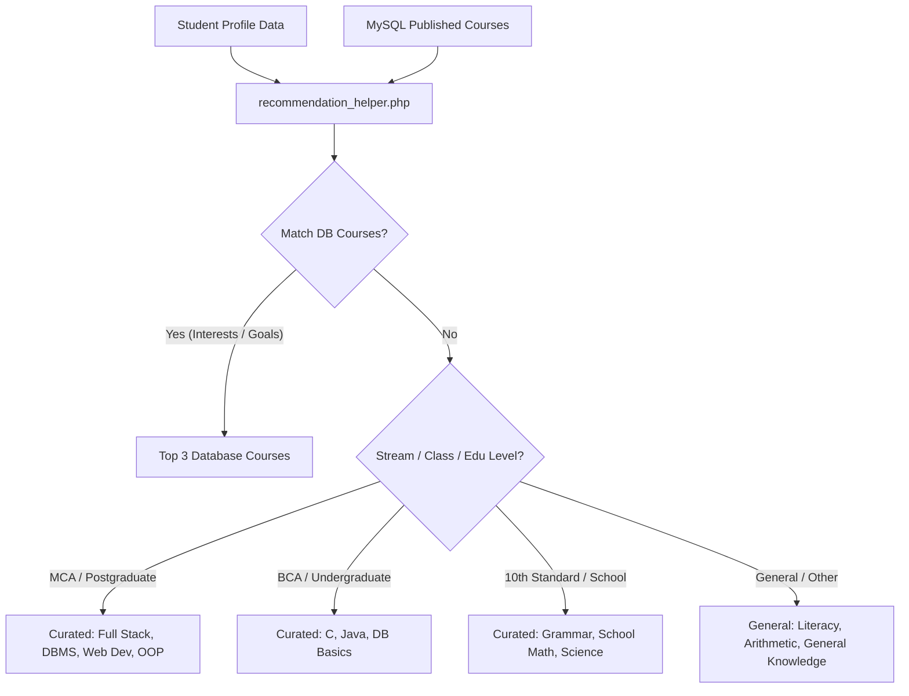

# Student Profile Upgrade & Recommendation Engine Specification

This document outlines the detailed architecture and components added to the **EduQuest Gamified Learning Platform** to support upgraded Student Profiles and automated profile-based learning recommendations.

---

## 1. Database Schema Extensions

The `students` table has been extended with the following columns to capture academic, geographic, and personalized learning characteristics:

| Column Name | Data Type | Default Value | Description |
| :--- | :--- | :--- | :--- |
| `school_name` | `VARCHAR(150)` | `NULL` | School, College, or Institute Name |
| `university_board` | `VARCHAR(150)` | `NULL` | Board (e.g., GSEB, CBSE) or Affiliated University |
| `academic_year` | `VARCHAR(20)` | `NULL` | Year of study (e.g., 2024-25) |
| `education_level` | `VARCHAR(50)` | `NULL` | School, Higher Secondary, Diploma, Undergraduate, Postgraduate |
| `preferred_language` | `VARCHAR(50)` | `NULL` | Preferred study medium (English, Hindi, Gujarati) |
| `learning_goal` | `VARCHAR(100)` | `NULL` | Core learning target (e.g., Math, Science, Computer Skills) |
| `skill_level` | `VARCHAR(50)` | `NULL` | Student familiarity (Beginner, Intermediate, Advanced) |
| `interests` | `VARCHAR(255)` | `NULL` | Comma-separated interests (English, Mathematics, Science, etc.) |

---

## 2. Upgraded Profile Screen (`profile.php`)

The Student section inside `profile.php` has been upgraded to support editing and validating all academic parameters:

- **Academic Text Inputs**: Added School / College Name, University / Board, and Academic Year fields.
- **Enumerated Dropdowns**: Created customized dropdown lists for:
  - **Education Level**: School, Higher Secondary, Diploma, Undergraduate, Postgraduate.
  - **Preferred Language**: English, Hindi, Gujarati.
  - **Learning Goal**: English Improvement, Mathematics, Science, Computer Skills, Exam Preparation, General Learning.
  - **Skill Level**: Beginner, Intermediate, Advanced.
- **Interests Multiselect**: Rendered responsive checkcards allowing students to toggle interests: *English, Mathematics, Science, Computer, General Knowledge*. The controller maps and joins selected checkboxes into a comma-separated database string on save.

---

## 3. Recommendation Engine Architecture (`includes/recommendation_helper.php`)

### Recommendation Logic Matching Rules:
1. **Database Course Matcher**:
   - Compares the student's selected `learning_goal` and `interests` list with categories and titles of published courses.
   - Maps student's `skill_level` to course `difficulty_level` (Beginner $\rightarrow$ easy, Intermediate $\rightarrow$ medium, Advanced $\rightarrow$ hard).
   - Automatically excludes courses in which the student is already enrolled.
2. **Curated Pathways Fallback**:
   - If the student profile matches specific academic patterns, the engine injects targeted curriculum pathway modules:
     - **Postgraduate / MCA Students**: Receives recommendations for *Full Stack Development*, *DBMS*, *Web Development*, and *Programming Fundamentals*.
     - **Undergraduate / BCA Students**: Receives recommendations for *C Programming Logic*, *Java Object Oriented Basics*, and *Database Fundamentals*.
     - **School / 10th Standard Students**: Receives recommendations for *English Grammar Mastery*, *Core School Mathematics*, and *Science Foundation*.

---

## 4. Student Dashboard Integration (`student/dashboard.php`)

A **Recommended For You** responsive section is added to the student dashboard:
- **Actual Database Courses**: Displays cards with images/placeholders, title, description, and instructor, plus a single-click **Enroll** form submit action.
- **Curated Pathway Cards**: Displays stylized cards featuring targeted subject icons, descriptions, and difficulty badge descriptors matching their educational profile.
