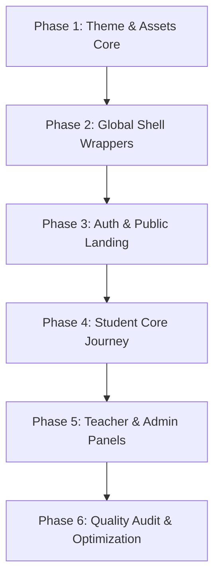

# EduQuest Rural Learning Platform: UI Integration Plan

This document details the plan to integrate the new Stitch HTML mockups (Project ID: `4484103301604691156`) into the existing PHP-based web application without breaking server-side database linkages.

---

## 1. Mapping Stitch Screens to PHP Pages

Below is the mapping of the 12 Stitch HTML mockups to the corresponding PHP scripts in the project:

| # | Stitch Screen | Target PHP File | Path / URL | Role / Context |
|---|---|---|---|---|
| 1 | `landing_branding.html` | `index.php` | `/index.php` | Public Landing Page |
| 2 | `registration.html` | `register.php` | `/register.php` | Public Registration Form |
| 3 | `login.html` | `login.php` | `/login.php` | Public Login Form |
| 4 | `student_dashboard_branding.html` | `student/dashboard.php` | `/student/dashboard.php` | Student Dashboard |
| 5 | `course.html` | `student/courses.php` | `/student/courses.php` | Student Course Selection |
| 6 | `lesson.html` | `student/lesson-view.php` | `/student/lesson-view.php` | Lesson Content Reading View |
| 7 | `quiz.html` | `student/quiz-view.php` | `/student/quiz-view.php` | Gamified Quiz / Quest Interface |
| 8 | `leaderboard.html` | `student/leaderboard.php` | `/student/leaderboard.php` | Platform Leaderboard & Standings |
| 9 | `achievement_branding.html`| `student/achievements.php` | `/student/achievements.php` | Badge Gallery & XP Summary |
| 10| `teacher_dashboard_branding.html` | `teacher/dashboard.php` | `/teacher/dashboard.php` | Teacher Overview Dashboard |
| 11| `reports.html` | `teacher/reports.php` & `teacher/progress.php` | `/teacher/reports.php` | Class Performance & Student Reports |
| 12| `admin_dashboard_branding.html`| `admin/dashboard.php` | `/admin/dashboard.php` | Administrator Master Control |

*Note: Administrative subsections (like `/admin/students.php`, `/admin/teachers.php`, `/admin/courses.php`, etc.) will adapt the sidebar/navbar wrappers and inherit the table templates from the catalog mapping.*

---

## 2. Reusable Layout Components

We can abstract the Stitch elements into the existing PHP include system to avoid code duplication:

*   **`includes/header.php` (Core Head Environment)**:
    *   Loads Tailwind CSS (via CDN) with standard plugins configuration.
    *   Loads Google Fonts (`Plus Jakarta Sans` and `Inter`).
    *   Loads Material Symbols Outlined stylesheet.
    *   Initializes dark/light theme config settings in JS to prevent page flicker.
    *   Renders the starting wrappers (`
`).
*   **`includes/sidebar.php` (Role-Based Drawer)**:
    *   Unified panel structure spanning desktop/mobile layouts.
    *   Applies a PHP conditional wrapper to render the matching navigation links depending on the logged-in role (`Admin`, `Teacher`, or `Student`).
    *   Incorporates the active page style indicator using current script name matching.
*   **`includes/navbar.php` (Global Actions Header)**:
    *   Displays gamified stats (Coins / Streak count) dynamically pulled from the database for logged-in students.
    *   Renders the language translator dropdown list and theme switcher toggle.
    *   Displays the authenticated user's name and circular letter-avatar dropdown.
*   **`includes/footer.php` (Closure & Scripts)**:
    *   Closes out global layout tags.
    *   Renders the legal/copyright copy using localized variables.
    *   Includes JS assets (Bootstrap 5 bundle script, Chart.js for data dashboards, and `app.js` for theme handling).

---

## 3. Files Requiring Modification

To achieve the premium, modern responsive redesign, the following files must be updated:

### Style Sheets & Templates (CSS/JS)
*   **`assets/css/style.css`**: Define CSS variables matching the Material 3 color palette. Implement utility styles for glassmorphism card containers, transition effects, custom scrollbars, and chart heights.
*   **`assets/js/app.js`**: Re-code the theme switcher logic to support the Material-3 Tailwind theme configuration system.

### Core Redirection & Authenticated Templates
*   **`includes/header.php`**, **`includes/sidebar.php`**, and **`includes/navbar.php`**: Injecting the Tailwind CSS engine and structures.

### Public Pages
*   **`index.php`**: Replace with the responsive sections from `landing_branding.html`, populating links dynamically.
*   **`login.php`** & **`register.php`**: Replace Bootstrap columns and container styles with the centered, glassmorphic layout details. Ensure translation functions (`__()`) and error alerts are fully integrated.

### Dynamic Student Dashboards
*   **`student/dashboard.php`**: Style key metrics (XP, streak, level) matching stats cards from the Stitch mockups. Adapt the quiz score chart to draw from the historical data array.
*   **`student/courses.php`**: Unify course listings using the new courses card style.
*   **`student/lesson-view.php`**: Structure reading viewport, side menu lists, and PDF resources blocks.
*   **`student/quiz-view.php`**: Integrate quest UI elements (question card, timer count, success/error choice buttons) into the interactive quiz execution loops.
*   **`student/leaderboard.php`**: Redesign podium views for top ranks, and map user ranks to the hoverable tabular grids.
*   **`student/achievements.php`**: Render badge inventory with lock/unlock filters, and plug-in detail modals using Javascript indicators.

---

## 4. Recommended Implementation Order

To ensure systematic development and avoid breaking functionality, we recommend executing the changes in the following sequence:

### Phase 1: Theme & Assets Core (Setup)
1.  Add Tailwind config, Google Fonts, and Material Symbols to `includes/header.php`.
2.  Add Material-3 theme styling properties to `assets/css/style.css`.
3.  Implement dark/light mode toggler scripts in `assets/js/app.js`.

### Phase 2: Global Shell Wrappers (Structure)
1.  Refactor `includes/sidebar.php` to use the Tailwind layout design with role checking.
2.  Refactor `includes/navbar.php` for user metrics, profile avatar, language selector, and responsive sidebar menu triggers.
3.  Update `includes/footer.php` to complete modern tag structures and link correct scripts.

### Phase 3: Access & Authentication (Entrance)
1.  Update the public landing page (`index.php`) with hero sections, statistics, and localized text.
2.  Redesign login and registration screens (`login.php`, `register.php`, `forgot-password.php`, `reset-password.php`).

### Phase 4: Student Core Journey (Gamification & Learning)
1.  Redesign the Student Dashboard (`student/dashboard.php`) including dynamic stats blocks.
2.  Integrate the Leaderboard (`student/leaderboard.php`) and Achievements/Badges (`student/achievements.php`) screens.
3.  Redesign Course Lists (`student/courses.php`) and Lesson Viewers (`student/lesson-view.php`).
4.  Implement the Quiz UI (`student/quiz-view.php`), mapping interactive state colors to options buttons.

### Phase 5: Teacher & Admin Panels (Management)
1.  Redesign the Teacher Dashboard (`teacher/dashboard.php`) and Reports (`teacher/reports.php`, `teacher/progress.php`).
2.  Redesign the Admin Dashboard (`admin/dashboard.php`) and administrative tables (e.g. badges editing, user lists).

### Phase 6: Quality Audit & Optimization (Verification)
1.  Check layout rendering across various screen configurations (Responsive check).
2.  Confirm language switching translations render correctly in GUI components.
3.  Ensure database integration behaves accurately.
